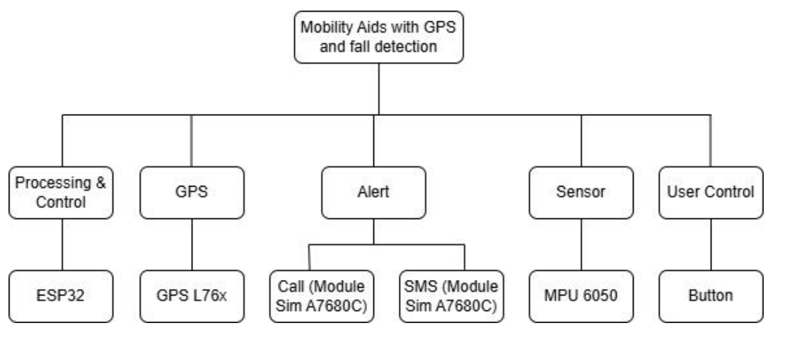
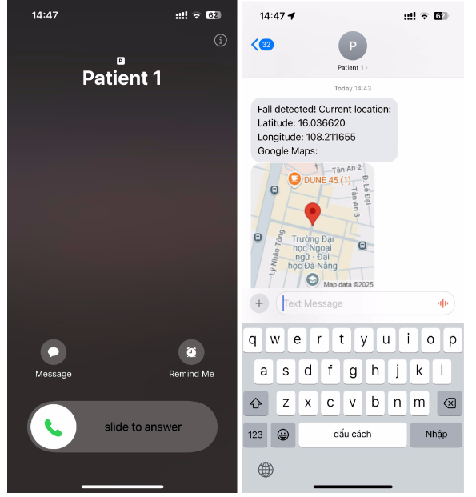
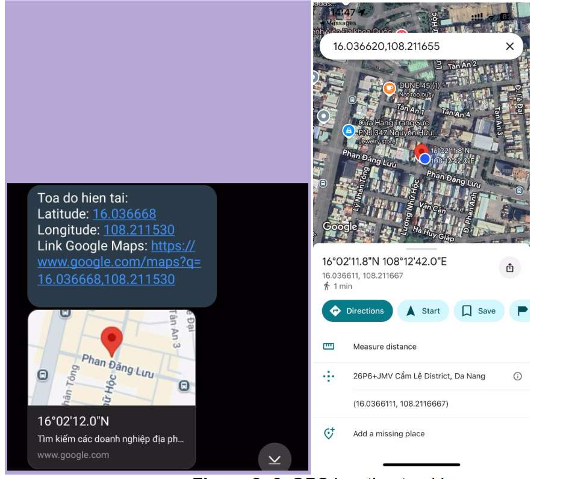
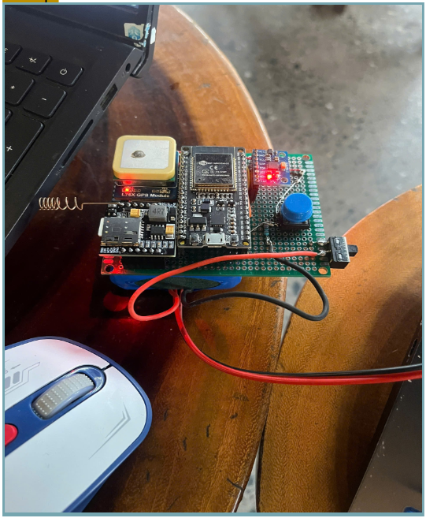

# 🦽 Mobility Aids with GPS & Fall Detection

**An IoT-based safety device designed to enhance independence and emergency response for the elderly and individuals with mobility challenges.**

*This project was developed as part of the Embedded System Program (ECE411) at Da Nang University of Science and Technology and won the **Prospect Award in the Fast Tech Show 2025**.*

---

## 📋 Overview

Individuals with mobility challenges, such as the elderly or disabled, often struggle to communicate their needs during emergencies like sudden falls, leading to delayed assistance. 

This project solves that problem by integrating a robust **fall detection algorithm** with **real-time GPS tracking**. When a fall is detected, or the manual SOS button is pressed, the device instantly captures the user's location and sends an emergency SMS/Call to their family members or caregivers.

### ✨ Key Features
- **🚨 Real-time Fall Detection:** Utilizes accelerometer data (Jerk magnitude) to distinguish between normal movements and hazardous falls.
- **📍 Precise Location Tracking:** Acquires real-time GPS coordinates (accuracy ≤ 2m).
- **📲 Instant Emergency Alerts:** Triggers automated SMS with Google Maps links and makes a phone call via 4G LTE upon detecting a fall.
- **🆘 Manual SOS Button:** A physical bypass button for immediate help in non-fall emergencies.
- **🔋 Optimized Power:** Designed to operate for 2-4 days continuously on a single charge.

---

## 🛠️ Hardware Architecture & Tech Stack

Through rigorous engineering trade-off matrices (evaluating Cost, Accuracy, Size, and Usability), the following hardware components were selected:

| Component | Module | Justification |
| :--- | :--- | :--- |
| **Microcontroller** | `ESP32` | Dual-core processing power, optimal size, and cost-effective. |
| **Motion Sensor** | `MPU-6050` | Highest accuracy (±0.001g) for calculating jerk magnitude compared to ADXL345. |
| **GPS Module** | `GPS L76X` | Superior horizontal position accuracy (2.0 meters CEP). |
| **Communication** | `SIM A7680C` | Ultra-compact LTE Cat 1 module for reliable SMS and voice calls. |

  <!-- BẠN HÃY THAY LINK ẢNH SƠ ĐỒ KHỐI VÀO ĐÂY -->
  
   
  <em>Level 0 System Functional Decomposition</em>

---

## 🧪 System Performance & Testing Results

The prototype underwent extensive acceptance and integration testing to ensure reliability in critical situations.

### 1. Fall Detection Algorithm (Jerk Magnitude)
We implemented a threshold-based algorithm relying on the Jerk magnitude (rate of change of acceleration). Testing showed that normal activities kept jerk values low (0.06 - 0.15), while simulated falls registered significantly higher values (>0.30), allowing the ESP32 to accurately trigger the alert state.

### 2. Location Tracking & SMS Delivery
The integration between the L76X GPS and A7680C SIM module achieved a **100% success rate** in outdoor testing.

  <!-- BẠN HÃY THAY LINK ẢNH TEST GPS VÀ SMS VÀO ĐÂY -->
  
  &nbsp; &nbsp;
  

### 3. Hardware Prototype
The entire system was successfully integrated into a compact unit weighing under 400 grams, making it suitable for attachment to wheelchairs or walking canes.

  <!-- BẠN HÃY THAY LINK ẢNH MẠCH THỰC TẾ VÀO ĐÂY -->
  

---
